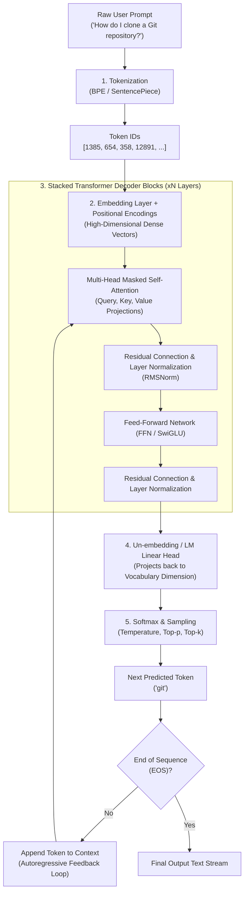

# Deep Learning and How Large Language Models (LLMs) Work

---

## 1. Introduction: From Traditional Programming to Deep Learning

In traditional computer programming, developers write explicit, rule-based algorithms: given a specific input $X$ and hand-crafted logic $f(X)$, the program yields output $Y$.

```
Traditional Programming:   Data + Rules   --> Answers
Machine Learning:          Data + Answers --> Rules (Model)
Deep Learning:             Hierarchical Layers of Learned Representations
```

**Deep Learning** is a specialized branch of Machine Learning founded on **Artificial Neural Networks (ANNs)** with many stacked processing layers ("deep" architectures). Rather than requiring human engineers to manually design features (such as regexes or handcrafted grammar trees for language), deep learning models automatically discover hierarchical representations directly from raw data—progressing from low-level patterns (tokens, punctuation) to abstract semantics (intent, tone, reasoning, and context).

---

## 2. Core Mathematical Foundations of Deep Learning

To understand how a multi-billion parameter model like Gemini or GPT functions, we first trace the basic computational unit of deep learning:

### 2.1 The Artificial Neuron (Perceptron)
A single artificial neuron takes an input vector $\mathbf{x} = [x_1, x_2, \dots, x_n]$, multiplies each element by a learnable weight $\mathbf{W}$, adds a learnable bias term $b$, and feeds the resulting scalar $z$ through a non-linear activation function $\sigma(z)$:

$$z = \sum_{i=1}^{n} w_i x_i + b = \mathbf{W}\mathbf{x} + b$$

$$a = \sigma(z)$$

- **Weights ($\mathbf{W}$):** Parameters that determine the importance or influence of each feature.
- **Bias ($b$):** An offset parameter allowing the neuron to activate even when inputs are zero.
- **Activation Function ($\sigma$):** Introduces non-linearity into the network. Without non-linear activation functions, stacking 100 neural network layers would mathematically collapse into a single linear transformation ($\mathbf{W}_2(\mathbf{W}_1\mathbf{x}) = \mathbf{W}_{combined}\mathbf{x}$), preventing the network from modeling complex, non-linear phenomena like human language. Modern transformers predominantly use activations like **GELU (Gaussian Error Linear Unit)** or **SwiGLU**.

### 2.2 Forward Propagation, Loss Functions, and Optimization
1. **Forward Pass:** Input data flows forward through the layers to generate a prediction $\hat{\mathbf{y}}$.
2. **Loss Function ($L$):** Measures the discrepancy between the model's prediction $\hat{\mathbf{y}}$ and the ground-truth target $\mathbf{y}$. For language modeling, the standard metric is **Cross-Entropy Loss**, quantifying how surprised the model is by the actual next word:
   $$L = -\sum_{k} y_k \log(\hat{y}_k)$$
3. **Backpropagation:** Using the **Chain Rule of Calculus**, the model computes the partial derivative (gradient) of the loss with respect to every weight parameter in the network:
   $$\frac{\partial L}{\partial w_{ij}} = \frac{\partial L}{\partial \hat{y}} \cdot \frac{\partial \hat{y}}{\partial z_j} \cdot \frac{\partial z_j}{\partial w_{ij}}$$
4. **Gradient Descent (Optimization):** An optimization algorithm (typically **AdamW**) updates the weights in the opposite direction of the gradient to minimize the loss:
   $$\mathbf{W} \leftarrow \mathbf{W} - \eta \nabla_{\mathbf{W}} L$$
   where $\eta$ is the learning rate.

---

## 3. What is a Large Language Model (LLM)?

At its core, a **Large Language Model (LLM)** is a probabilistic autoregressive next-token predictor. 

Given a sequence of preceding tokens $(w_1, w_2, \dots, w_{t-1})$, the model calculates a conditional probability distribution over the entire vocabulary $V$ to predict the most plausible next token $w_t$:

$$P(w_1, w_2, \dots, w_T) = \prod_{t=1}^{T} P(w_t \mid w_1, w_2, \dots, w_{t-1})$$

While this sounds like a glorified autocomplete, scaling this objective across **hundreds of billions of parameters** and **trillions of tokens** of world knowledge forces the network to learn grammar, factual knowledge, software synthesis, logical deduction, and contextual reasoning as emergent properties.

---

## 4. The LLM Processing Pipeline: From Prompt to Response

An LLM processes text through a structured sequence of discrete transformations:



### 4.1 Step 1: Tokenization
Computers cannot process raw characters or words directly. Text is split into discrete chunks called **tokens** using algorithms such as **Byte-Pair Encoding (BPE)**. 
- Words like `"unbelievable"` might be split into subwords: `["un", "believ", "able"]`.
- Code snippets like `"git checkout -b feature"` are mapped to precise integer indices from a fixed vocabulary (typically 32,000 to 128,000 unique tokens).

### 4.2 Step 2: Vector Embeddings and Positional Encoding
Each token ID is mapped to a continuous dense vector in high-dimensional space (e.g., $d_{model} = 4096$). 
- In this vector space, semantically related words are located close to each other ($\vec{v}_{\text{git}}$ and $\vec{v}_{\text{commit}}$ have high cosine similarity).
- Because transformer self-attention operates over all tokens simultaneously without inherent sequential order, **Positional Encodings** (such as **Rotary Position Embedding / RoPE**) are added or applied to inject information about each token's position in the sentence.

### 4.3 Step 3: The Transformer Architecture and Self-Attention
Introduced in the landmark 2017 paper *"Attention Is All You Need"*, the **Transformer** revolutionized artificial intelligence by replacing sequential Recurrent Neural Networks (RNNs) with **Self-Attention**.

#### The Intuition of Queries, Keys, and Values
In Self-Attention, every token in the input calculates three distinct vector representations by multiplying its embedding by learned projection matrices:
1. **Query ($\mathbf{Q}$):** What this token is searching for.
2. **Key ($\mathbf{K}$):** What this token contains (its label/identifier).
3. **Value ($\mathbf{V}$):** The actual substantive information this token contributes if matched.

The attention score between all pairs of tokens is calculated using the **Scaled Dot-Product Attention** formula:

$$\text{Attention}(\mathbf{Q}, \mathbf{K}, \mathbf{V}) = \text{softmax}\left(\frac{\mathbf{Q}\mathbf{K}^T}{\sqrt{d_k}}\right)\mathbf{V}$$

- The dot product $\mathbf{Q}\mathbf{K}^T$ measures how relevant every token is to every other token.
- Dividing by $\sqrt{d_k}$ stabilizes the gradients during training.
- The `softmax` normalizes these scores into attention weights between 0 and 1 (summing to 1).
- In decoder models, a **causal mask** ensures a token can only attend to previous tokens and itself, never future tokens.

#### Multi-Head Attention
Instead of performing attention once, transformers run **Multi-Head Attention** across $h$ parallel heads (e.g., 32 or 64 heads). Each head specializes in capturing different linguistic relationships:
- One head might track syntax (verbs matching subjects).
- Another tracks entity references (pronouns like "it" pointing to "repository").
- Another tracks code syntax (closing brackets matching opening brackets).

#### Residual Connections and Layer Normalization
After attention and feed-forward layers, the architecture applies:
- **Residual (Skip) Connections:** $\mathbf{x} + \text{SubLayer}(\mathbf{x})$, enabling gradient signals to flow backwards through hundreds of layers without vanishing.
- **Layer Normalization (RMSNorm):** Normalizes activations across features to keep numerical ranges stable.

### 4.4 Step 4: Decoding and Generation Strategies
The output of the final transformer block is projected back to vocabulary dimensions (e.g., 50,000 probabilities). To select the next token:
- **Greedy Search:** Always chooses the token with highest probability (can lead to repetitive loops).
- **Temperature ($T$):** Scales logits before softmax. Higher temperature ($T > 1.0$) flattens the distribution for creative diversity; lower temperature ($T < 0.5$) sharpens it for factual, deterministic precision.
- **Top-$p$ (Nucleus Sampling):** Dynamically restricts candidates to the smallest subset of tokens whose cumulative probability exceeds $p$ (e.g., $p = 0.9$).
- **Top-$k$ Sampling:** Restricts candidates to the top $k$ highest-probability tokens.

---

## 5. The Training Lifecycle of Modern LLMs

Building a production-grade LLM requires a 3-stage lifecycle:

```
[Phase 1: Pre-training]       -->  [Phase 2: Fine-Tuning (SFT)]  -->  [Phase 3: Alignment (RLHF/DPO)]
Massive raw text (trillions)       Curated instruction pairs          Human preference ratings
Self-supervised loss               Supervised learning                Reward modeling / DPO
Builds world knowledge & grammar   Teaches instruction following      Enforces safety & helpfulness
```

1. **Pre-training:** The most computationally expensive stage. The model reads hundreds of billions of words from internet pages, books, papers, and code repositories, predicting masked or next tokens.
2. **Supervised Fine-Tuning (SFT):** The pre-trained base model is trained on curated datasets of instruction-response pairs (e.g., `"User: How do I undo a commit in Git?"` $\rightarrow$ `"Assistant: You can use git revert or git reset..."`).
3. **Human Alignment (RLHF / DPO):** Reinforcement Learning from Human Feedback aligns the model's behavior with human values, teaching it to decline harmful requests, acknowledge uncertainty, and reduce hallucinations.

---

## 6. Real-World Limitations and the Role of RAG (GitGuru)

While modern LLMs exhibit impressive linguistic capabilities, they have fundamental architectural limitations:
1. **Hallucination:** Because LLMs are probabilistic word predictors rather than factual databases, they can generate fluent, convincing, but completely fabricated information (e.g. inventing non-existent Git flags like `git merge --force-wipe`).
2. **Knowledge Cutoff:** An LLM only knows information present in its training dataset up to its training cutoff date.
3. **Lack of Domain Grounding:** Generalist LLMs often lack organization-specific guidelines or the latest internal repository conventions.

### How GitGuru Bridges the Gap with Retrieval-Augmented Generation (RAG)
To solve these limitations, systems like **GitGuru** implement **Retrieval-Augmented Generation (RAG)**:
1. **User asks:** *"How do I fix a detached HEAD error?"*
2. **Smart Retrieval:** GitGuru uses TF-IDF / vector search (`app/smart_search.py`) to search official, curated Git SCM and GitHub documentation records.
3. **Grounding Context:** The verified documentation snippet is inserted into the prompt.
4. **LLM Generation:** The LLM generates the response strictly grounded in the retrieved truth, eliminating hallucinations and providing exact citation URLs.

---
*Authored for the GitGuru Educational System — GenAI Engineering.*

